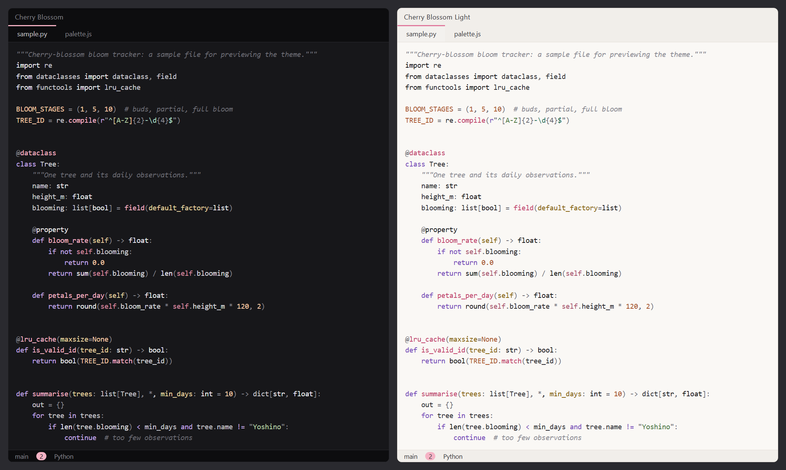

# Cherry Blossom

A personal VS Code theme, dark and light, in the palette of [cassie7511.github.io](https://cassie7511.github.io):
near-black, grays, and occasional cherry-blossom pink, with a few soft companion colors for code.



It is **Tokyo Night with the colors swapped**. Every UI key, code-coloring rule and italic from
Tokyo Night is kept, so the same parts of the code and interface get color. Only the colors change,
and none of them are blue.

**Cherry Blossom** (dark) puts the pink on function names, with soft lavender keywords.
**Cherry Blossom Light** is built the same way from Tokyo Night Light, on a warm off-white
(`#faf8f5`) with warm grays. On a light background the site's pastels are deepened so they stay
readable, and the pastel pink is kept for buttons and badges.

Wherever Tokyo Night tints a highlight blue (selected text, the selected row in lists and menus,
the current line, scrollbars, badges), these themes tint it pink. In the Claude Code panel,
`inline code` and @-mention chips are pink, **auto mode** shows in pink and **plan mode** in violet.

## Files

| File | What it is |
|---|---|
| `palette.js` | **The dark theme's colors.** Site colors, companions, and the maps from Tokyo Night's colors to these |
| `palette-light.js` | **The light theme's colors.** Borrows the dark theme's choice of what gets which color, rule by rule |
| `build.js` | Generates `themes/*.json` from Tokyo Night + `palette.js`, checks the result, rewrites the theme list in `package.json` |
| `preview.js` | Opens a separate preview window with the theme loaded |
| `themes/` | Generated. Never edit by hand |
| `vendor/` | Tokyo Night's original theme file (the template) and its MIT license |
| `samples/` | Small Python, JS, HTML, CSS, SQL, Markdown and JSON files to look at |
| `docs/preview.png` | The image above |
| `build-report.txt` | Every Tokyo color and what it became, written by each build |

## Tweak a color

1. Edit a hex in `palette.js` (dark) or `palette-light.js` (light).
2. `node build.js`
3. An open preview window updates on its own.

The build **refuses to write** if:
- a Tokyo Night color has no mapping
- any blue is left
- a code color is too dim to read (under 4.5:1 against the editor, or 3:1 for comments)
- a key piece of interface text is too dim to read
- the structure no longer matches Tokyo Night

## Preview

```
node preview.js                     # the samples
node preview.js some\file.py        # any files or folders
```

The preview window keeps its own settings in `.preview-profile/`, so switching themes there
(Ctrl+K Ctrl+T) leaves your normal VS Code alone.

## Install / update

```
npx --yes @vscode/vsce package --allow-missing-repository
code --install-extension cherry-blossom-0.3.0.vsix
```

Then pick **Cherry Blossom** or **Cherry Blossom Light** with Ctrl+K Ctrl+T. To update it later, bump `version` in
`package.json`, then package and install again.
