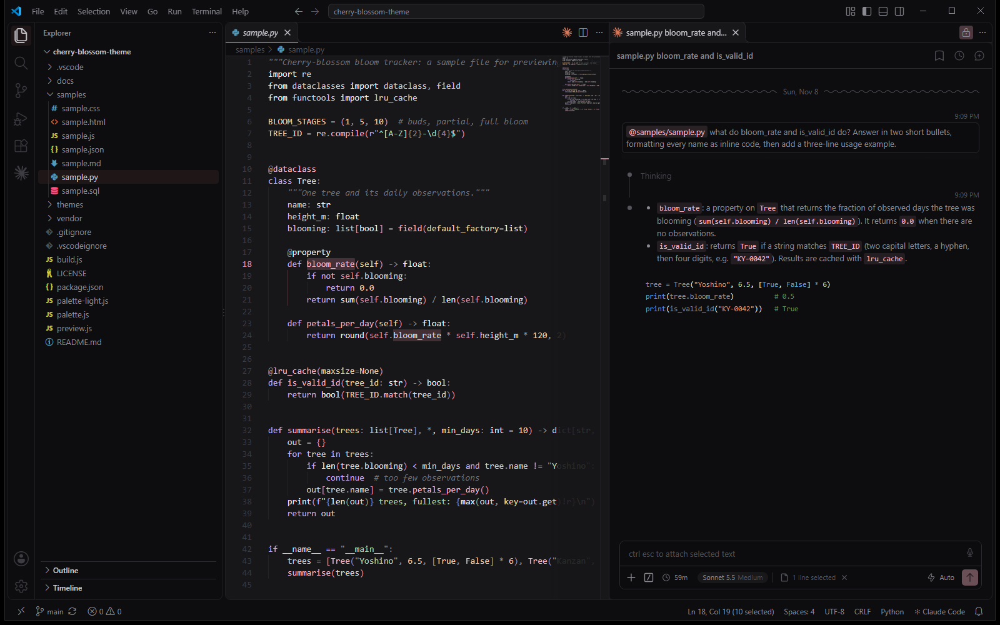
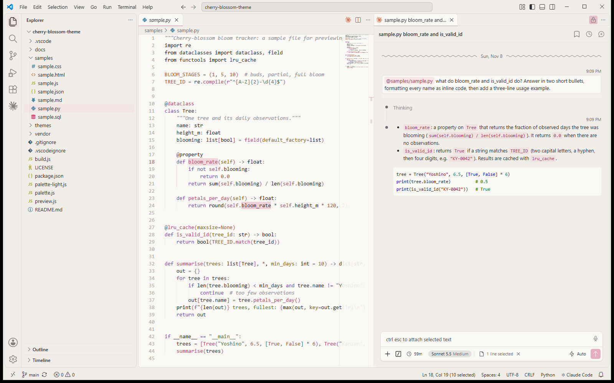

# Night Sakura

Dark and light VS Code themes in black, gray and cherry-blossom pink.

## Install

Install **Night Sakura** from the [VS Code Marketplace](https://marketplace.visualstudio.com/items?itemName=Cassie11.night-sakura) or the Extensions view, then pick **Night Sakura** or **Night Sakura Light** with Ctrl+K Ctrl+T.

## Change a color

Edit `palette.js` (dark) or `palette-light.js` (light) and run `node build.js`. The build won't save a theme with leftover blue or hard-to-read text.
